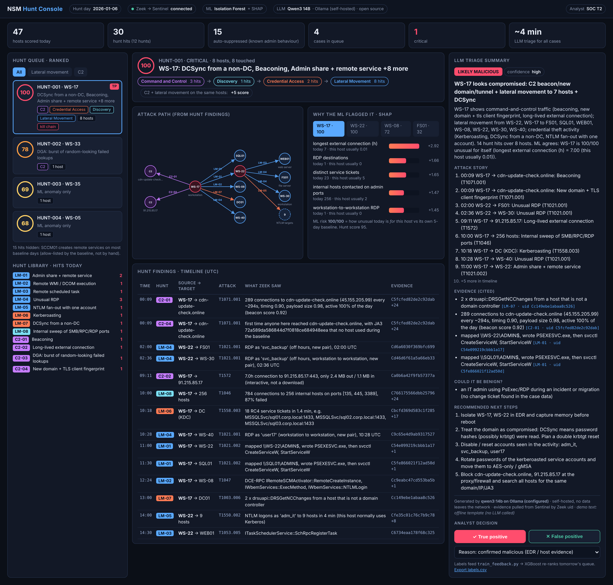

# Zeek AI Threat Hunting

AI-assisted network security monitoring on Zeek logs:

```
Zeek ─► SIEM (Microsoft Sentinel) ─► hunts + ML risk score ─► SHAP (why) ─► open-source LLM (Ollama) writes the triage ─► analyst TP/FP ─► feedback retrains the model
```



| Folder | What it is |
|---|---|
| [`threat-hunting/`](threat-hunting/) | Daily threat hunting for **lateral movement** (PsExec, WMI, RDP, pass-the-hash, Kerberoasting, DCSync, sweeps) and **C2** (beaconing, long connections, DGA, new domain + JA3). 12 ATT&CK-mapped hunts, per-host Isolation Forest + SHAP, attack-path cases, LLM triage via Ollama, analyst dashboard, Sentinel KQL. |
| [`ml-scoring/`](ml-scoring/) | Connection-centric risk scoring (host → domain per day): beaconing, DGA, DNS tunnelling, cousin domains, exfil. Isolation Forest + SHAP, XGBoost on analyst feedback. |

Both run on synthetic Zeek data out of the box:

```bash
cd threat-hunting && pip install -r requirements.txt && bash run_demo.sh
```

**Status: prototype.** Tested only on synthetic data; thresholds and Sentinel table names are guesses (marked `GUESS:` in the code). The LLM runs locally through Ollama (`ollama pull qwen3:14b`), so no logs leave your network.
