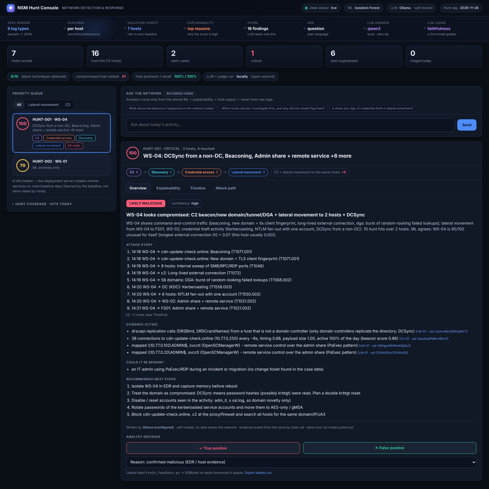

# Zeek LLM Threat Hunting

**A prototype for building an AI-assisted NSM (Network Security Monitoring) platform.** It watches Zeek network logs, scores every host with machine learning, explains each score with an explainability layer, and lets an analyst ask in plain language *"what abnormal behaviour happened on the network today?"* — the answer is written by an open-source LLM from the platform's own output, and a second LLM judges it.



*The Hunt Console: a priority queue of ranked cases on the left, and a tabbed case detail (Overview, Explainability, Timeline, Attack path) on the right. The pipeline strip across the top shows each stage with its live counts; the ribbon under it shows the lab's detection scores. "Ask the network" is a chat — click a host in the attack path to jump to its explanation, and press TP/FP to feed the re-ranker.*

**[Live static demo →](https://fattah-s.github.io/Zeek-LLM-threat-hunting/)** — a hosted snapshot of a real attack day. The chat there replays recorded answers (there is no server behind a static page). To chat **live** — ask any question and have the open-source LLM answer it from today's results — run the lab below; the chat is served at `http://localhost:8080`.

The pipeline order is fixed, and the LLM sits at the very end as the translator, never as the detector:

```
Zeek sensor → feature extraction → ML model (Isolation Forest, a risk score per host)
            → Explainability (why the score is high) → store → analyst asks → LLM answers from the store → LLM judge
```

The explainability layer explains a model that turns numeric features into a score, so it has to come **before** the LLM: the LLM reads raw logs and is not that kind of model. The Isolation Forest and the hunts decide what is anomalous; the explainability layer says why; the LLM only translates it for the analyst.

There are two ways to run it:

| | What it does | Needs |
|---|---|---|
| **The lab** (this README) | Builds a small Windows-style network in Docker, runs clean "days" and one attack "day" with **real protocols** (Samba AD, Kerberos, SMB, DCE-RPC, Impacket), captures the traffic with a **real Zeek sensor**, and runs the whole pipeline. One command. | Docker |
| **Synthetic** ([`synthetic/`](synthetic/)) | The same detections on generated Zeek logs, no Docker, in about a minute. Good for reading the code. | Python |

---

## Quick start (the lab)

```bash
git clone https://github.com/Fattah-S/zeek-llm-threat-hunting.git
cd zeek-llm-threat-hunting
docker compose up --build
```

Open **http://localhost:8080**. Over a few minutes the page fills in as each stage finishes: the network generates traffic, the Zeek sensor turns packets into logs, the pipeline scores the hosts, and the dashboard shows the ranked hunts with their plain-language explanations. Then **chat** with it in *Ask the network* — this is a live, multi-turn conversation: each question (and your follow-ups) is answered by the local LLM from the day's stored results, with the second model's judge grade shown under each answer.

The open-source LLMs run in a local **Ollama** container, so no log data ever leaves the machine. The models download themselves on first run (about 6 GB); until they are ready, the LLM answer falls back to a template and the dashboard says so.

| Action | Command |
|---|---|
| Re-run the whole thing from scratch | `docker compose down -v && docker compose up --build` |
| Just re-score (keep the captured traffic) | `docker compose up --build pipeline` |
| Hunt in your own capture | drop a `.pcap` in the `pcap` volume under `byo/`, or see [below](#bring-your-own-pcap) |
| Smaller models (less RAM) | edit `LLM_MODEL` / `JUDGE_MODEL` in `.env.example` |

---

## What the lab builds

A small Active Directory network, each host a container on `10.77.0.0/24`:

| Host | Role | Why it's here |
|---|---|---|
| **DC01** | Samba AD domain controller (Kerberos, LDAP, DNS, SMB, DRSUAPI) | real tickets, real replication — DCSync actually talks to it |
| **FS01** | file server (SMB) | normal file access, and a lateral-movement target |
| **SCCM01** | software deployment | copies an installer to each workstation's `ADMIN$` and starts a service **every day** — byte-for-byte this looks like PsExec, and it's the classic false positive the platform must learn to ignore |
| **WS-01…05** | workstations | normal users: web, file shares, Kerberos logons |
| **WS-04** | the compromised workstation | runs the intrusion on the attack day, on top of its normal traffic |
| **internet** | public DNS + web | everything outside the company |
| **C2** | the attacker's server | beacon callbacks and an interactive tunnel |

The **orchestrator** runs the days: three clean baseline sessions, then one attack session. Every container mirrors the packets it receives, and the **Zeek sensor** merges them per session (what a SPAN port would see) and writes JSON logs.

### The intrusion (real tools, from WS-04)

Each step uses the real protocol, so Zeek sees what it would on a real network. Ground truth is written to `ground_truth.json`, which only the evaluation reads.

| Step | Technique | ATT&CK | Hunt |
|---|---|---|---|
| HTTPS beacon to `cdn-update-check.online`, ~8 s with 20% jitter | C2 beaconing | T1071.001 | C2-01 |
| long-lived TLS tunnel to the C2 on 8443 | C2 over a non-standard channel | T1572 | C2-02 |
| ~60 random `.info` lookups, mostly NXDOMAIN | domain generation algorithm | T1568.002 | C2-03 |
| sweep of 445/135/3389 across the subnet | network service discovery | T1046 | LM-08 |
| RC4 service tickets for 6 service accounts | Kerberoasting | T1558.003 | LM-06 |
| `ADMIN$` + `PSEXESVC.exe` + `svcctl` on WS-02 and FS01 | remote service execution (PsExec) | T1021.002, T1569.002 | LM-01 |
| drsuapi replication from a workstation | DCSync | T1003.006 | LM-07 |
| NTLM logons with a stolen admin hash to many hosts | pass-the-hash | T1550.002 | LM-05 |
| DCOM / scheduled-task attempts | WMI / scheduled task | T1047 / T1053.005 | LM-02 / LM-03 |

---

## How the pipeline works

```
┌─ lab (Docker) ────────────┐   ┌─ Zeek ─┐   ┌─ pipeline (one container) ───────────────────────────────┐
│ AD DC, servers,           │   │ sensor │   │ hunts.py   12 ATT&CK hunts ─────────────┐               │
│ workstations, C2.         │──►│ pcap → │──►│ hunt.py    features → IsolationForest → Explainability → score    │
│ Real Kerberos/SMB/RPC,    │   │ JSON   │   │            group hosts into cases (attack path)         │
│ real Impacket attack.     │   │ logs   │   │ store.py   SQLite: runs, hosts, findings, Q&A, labels   │
└───────────────────────────┘   └────────┘   │ triage.py  per-case triage card (Ollama)                │
                                             │ server.py  dashboard + Ask-the-network API              │
                                             │ ask.py     retrieve from store → LLM answer → judge.py   │
                                             │ evaluate.py detection + answer-quality metrics           │
                                             └──────────────────────────────────────────────────────────┘
                                                        ▲ Ollama container (qwen3 answerer, gemma3 judge, embeddings)
```

1. **Zeek** turns packets into `conn/dns/ssl/kerberos/ntlm/smb_mapping/smb_files/dce_rpc/rdp` logs.
2. **Hunts** (`hunts.py`) look for known attacker techniques, each with an ATT&CK id and the Zeek `uid`s that prove it. A `(source, hunt)` pair seen on most baseline days (the deployment server) is suppressed as known admin behaviour.
3. **ML** (`hunt.py`): per-host features go to an **Isolation Forest** trained on the baseline. Each host is compared with **its own** normal (UEBA style), so a server that always talks to 15 hosts is not flagged for doing so. The **explainability layer** gives the top reasons in plain words: *"RDP destinations = 2 (this host usually 0)"*.
4. **Store** (`store.py`): the scored day, the cases, the findings and the explanation reasons go to SQLite. **The LLM only ever reads from here.**
5. **Ask the network** (`ask.py`): the analyst's question plus the day's top behaviours go to the LLM in one call. It must cite a finding id or an explanation reason for every claim, and answer only from the store.
6. **Judge** (`judge.py`): a different open-source model grades the answer for faithfulness, relevance, completeness and actionability, and lists any unsupported claim.
7. **Feedback**: the analyst presses TP/FP in the dashboard; labels go to the store and train an XGBoost re-ranker (`train_feedback.py`).

The detections, the ML and the explainability layer are documented in detail in [`pipeline/DETECTIONS.md`](pipeline/DETECTIONS.md).

---

## Evaluating the answers

`evaluate.py` scores the attack day against the ground truth (which the pipeline never sees) on two levels:

**Detection** — did each technique's hunt fire on the compromised host, what rank did its case get, host precision/recall, and how much known admin noise was suppressed.

**Answer quality** — for each analyst question:
- **LLM-as-a-judge**: a second model (a different family than the answerer, to avoid self-preference) grades faithfulness / relevance / completeness / actionability and flags unsupported claims.
- **Algorithmic metrics** against the ground truth, no LLM involved: **host F1** and **technique F1** (what the answer named vs what actually happened), **semantic similarity** (embedding cosine to a reference answer, TF-IDF cosine as a fallback), and **ROUGE-L**. Embedding cosine is used instead of BERTScore so it runs on the same Ollama server with no extra gigabytes of PyTorch.

Both are compared against a no-LLM **template** answer (the same facts, stitched by a template) — the baseline the LLM has to beat.

Results land in `results/RESULTS.md` and `results/metrics.json`, and a snapshot is checked in under [`results/`](results/).

---

## Bring your own PCAP

```bash
docker compose cp mycapture.pcap sensor:/pcap/byo/mycapture.pcap   # Zeek logs it to /logs/byo-mycapture
# or point the pipeline at any folder of Zeek JSON logs:
python pipeline/hunt.py --baseline '/logs/baseline-*' --day /logs/byo-mycapture --out out --hosts pipeline/hostnames.json
```

Public malware-traffic PCAPs (malware-traffic-analysis.net, the Stratosphere/CTU datasets) drop straight in. Set `NSM_INTERNAL_CIDRS`, `NSM_WORKSTATION_CIDRS` and `NSM_DCS` in `.env.example` to match the capture's addressing, and give `hostnames.json` the IP→name/role map if you have one.

---

## Project layout

```
docker-compose.yml          the whole lab + the NSM platform, one command
.env.example                models and network config
lab/                        the simulated network
  Dockerfile  entrypoint.sh  one image, ROLE picks the behaviour
  role_dc.sh  role_smb.sh  role_internet.sh  orchestrator.sh
  traffic/    benign.py  admin_noise.py  attack.py  web.py   real protocol traffic (Impacket)
sensor/                     Zeek sensor: merge per-host pcaps, run Zeek, emit JSON logs
  run_sensor.sh  merge_pcaps.py  local.zeek
pipeline/                   the NSM platform
  hunts.py hunt.py          12 hunts, Isolation Forest, explainability, case grouping
  store.py                  SQLite store (the LLM reads only this)
  ask.py llm.py             retrieve from the store, ask the local LLM
  judge.py                  LLM-as-a-judge + algorithmic metrics
  triage.py                 per-case triage cards
  evaluate.py               detection + answer-quality metrics vs ground truth
  server.py build_dashboard.py  dashboard + Ask-the-network API
  train_feedback.py         XGBoost re-ranker from analyst TP/FP
  kql/hunts.kql             the same hunts as Microsoft Sentinel KQL
  DETECTIONS.md             detection reference
synthetic/                  the same detections on generated logs, no Docker
results/                    checked-in results snapshot
ml-scoring/                 earlier connection-centric scorer (beaconing, DGA, DNS tunnelling, exfil)
```

---

## Status and limitations

This is a **prototype**, built to show the shape of an NSM platform end to end, not a production detector.

- **The lab is synthetic and loud.** The attack is deliberate and the baseline is clean by construction, so the detection numbers are a lab result, not a production claim. Real networks have backup jobs, vulnerability scanners and helpdesk tools that trip the hunts until the baseline learns them.
- **Time is compressed.** A "day" is a few minutes. Beacon intervals and "long" connections are scaled down (`NSM_LONG_CONN_SECONDS`); a real deployment uses 24-hour windows.
- **Samba is not Windows.** A few steps (WMI, remote scheduled task, the final DCSync replication pull) are refused by Samba, so Zeek sees the *attempt* (the DCE-RPC bind and calls) rather than a success. That attempt is exactly what the hunt keys on, and it's noted where it happens.
- **Thresholds are tuned on this data.** They live at the top of `hunts.py` and in `.env.example`.
- **Sentinel KQL is untested.** `pipeline/kql/hunts.kql` mirrors the hunts; the table and column names are guesses to adjust to your workspace.

## License

[MIT](LICENSE). Bundled fonts, if any, keep their own licenses.
